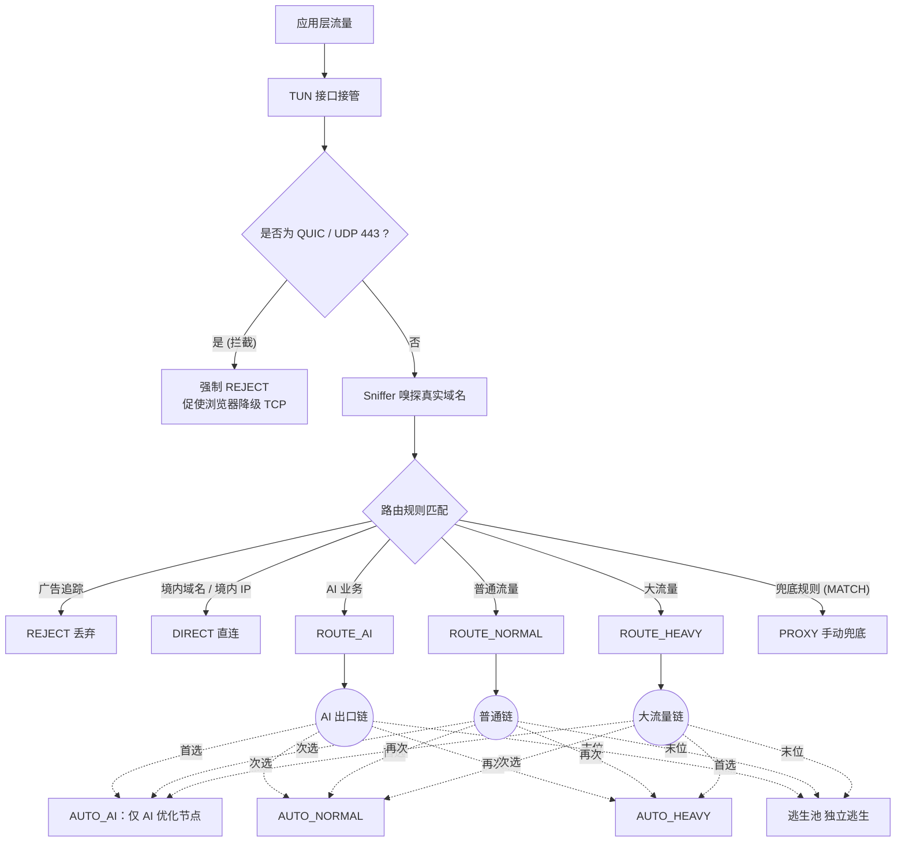
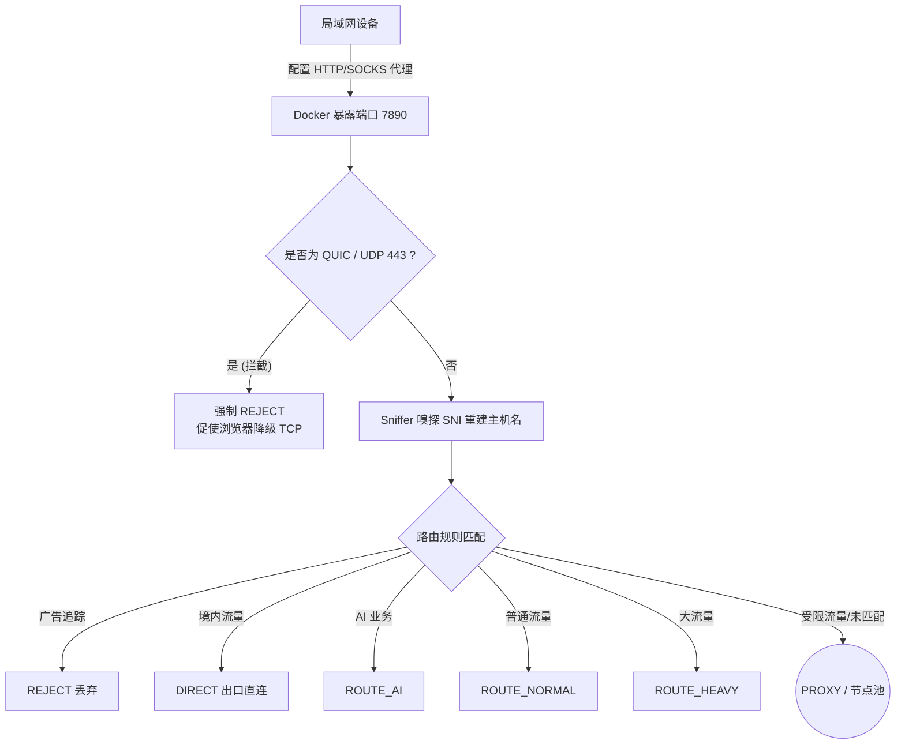

创建这个仓库的初衷非常简单：在日常折腾网络的过程中，我厌倦了以下痛点：

1. **不想依赖特定机场的分流规则**：很多机场自带的规则极其臃肿或常年失修。
2. **不想换机场就换规则**：每次更换服务商，都要重新习惯一套新的路由逻辑，成本太高。
3. **多机场混合使用困难**：市面上极少有开箱即用的、能完美将多个机场节点混合测速并智能调度的配置。
4. **想要一套简洁且合理的策略**：通过不断地实践与摸索，总结出了一套在实际体验中稳定、高效的代理组策略。

这并不是什么庞大复杂的工程，而是我个人实践出的一套**「白名单模式 + 智能兜底」**的配置模板集合。

为兼顾不同用户的机场订阅情况，仓库提供 **8 份配置模板**（4 种设备环境 × 单机场 / 双机场）。

# 一、配置适用设备与版本矩阵

请根据**运行设备**与**持有的机场订阅数量**选择对应模板：

| 运行环境 | 单机场模板（1 个订阅链接） | 双机场模板（2 个订阅冗余/容灾） | 适用客户端与说明 |
| :--- | :--- | :--- | :--- |
| 💻 **桌面版 (Desktop)** | `mihomo_config_desktop_single_template.yaml` | `mihomo_config_desktop_dual_template.yaml` | Windows / macOS / Linux。适配 Clash Verge Rev、Mihomo Party 等完整内核客户端。 |
| 🤖 **安卓版 (Android)** | `mihomo_config_android_single_template.yaml` | `mihomo_config_android_dual_template.yaml` | Android 手机/平板。适配 Clash for Android、Surfboard、FlClash 等。 |
| 🍏 **iOS 版 (iOS)** | `mihomo_config_ios_single_template.yaml` | `mihomo_config_ios_dual_template.yaml` | iPhone / iPad。**iOS 上没有成熟的 Mihomo 客户端，实际普遍用 Stash 或 Shadowrocket；本仓库按 Stash 适配**，详见下文第七节。 |
| 🐳 **Docker/NAS 版** | `mihomo_config_docker_single_template.yaml` | `mihomo_config_docker_dual_template.yaml` | NAS（群晖/极空间）或 Linux 服务器。不开 TUN，局域网暴露端口供其他设备连接。 |

## 单机场与双机场版本的架构差异

*   **单机场模板（`*_single_template.yaml`）**：
    *   **极简接入**：`proxy-providers` 仅含单一 `sub_nodes`，填入 1 个订阅链接即可启动，无需改策略组语法。
    *   **两个组各司其职**：`AUTO` 是自动选优的节点池，业务规则直接指向它；`PROXY` 是手动逃生口兼最终兜底。
*   **双机场模板（`*_dual_template.yaml`）**：
    *   **双源容灾**：`proxy-providers` 含 `sub_nodes_1` 与 `sub_nodes_2`。
    *   **跨机场测速聚合**：`AUTO` 跨双机场全量聚合优选。
    *   **单机场一键逃生**：顶层 `PROXY` 额外提供独立的 `AUTO_1`（机场1优选）与 `AUTO_2`（机场2优选），单机场大面积故障时可在 UI 一键切至备用机场。

8 份模板都**不设 `ROUTE_*` 层**，只有 `AUTO`（双机场另加 `AUTO_1` / `AUTO_2`）。模板注释在本次改动中补充了个人配置的分池建议：若订阅能按节点名识别普通、大流量与 AI 优化出口，可参照个人配置拆出 `AUTO_NORMAL` / `AUTO_HEAVY` / `AUTO_AI` 三个池，AI 业务可另建 `ROUTE_AI`，按「AI 出口 → 普通池 → 大流量池 → 逃生池」排序。

# 二、4 类运行环境的横向对比与核心差异

| 特性 / 运行环境 | Desktop（桌面） | Android（安卓） | iOS（苹果） | Docker（NAS） |
| :--- | :--- | :--- | :--- | :--- |
| **TUN 虚拟网卡** | ✅ 开启（`mixed` 栈） | ✅ 开启（`gvisor`） | ⚪ 由 Stash 的 VPN profile 接管 | ⚪ 关闭（仅暴露 7890 端口） |
| **Sniffer（流量嗅探）** | ✅ 开启 | ✅ 开启 | ⚪ 不使用，Stash 自行识别 | ✅ 开启（嗅探 SNI 防局域网 App 纯 IP 误判） |
| **规则集格式** | `.mrs`（Mihomo 编译格式） | `.mrs` | **`.yaml` payload**（Stash 不认 `.mrs`） | `.mrs` |
| **QUIC 阻断（`AND,…` 逻辑规则）** | ✅ 启用 | ✅ 启用 | ⚠️ 注释保留，待实测 | ✅ 启用 |
| **游戏下载直连** | ✅ 包含 | ⚪ 剔除 | ⚪ 剔除 | ✅ 包含 |
| **Steam 剩余流量直连（`steam`）** | ✅ 包含 | ⚪ 剔除 | ⚪ 剔除 | ✅ 包含 |
| **Windows 更新直连（`win_update`）** | ✅ 包含 | ⚪ 剔除 | ⚪ 剔除 | ✅ 包含 |
| **CDN 边缘 IP 层（快照计 1033 条 CIDR）** | ✅ 包含 | ✅ 包含 | ⚪ 剔除（守 15MB 内存红线） | ✅ 包含 |
| **节点过滤** | ✅ `filter` / `exclude-filter` | ✅ 同左 | ✅ 组级同左；订阅级用负向先行断言 | ✅ `filter` / `exclude-filter` |
| **外部管理接口** | `127.0.0.1:9090` | 不启用 | 不启用 | `0.0.0.0:9090`（供局域网面板） |

4 份个人配置都含 AI 专用出口层（`ROUTE_AI` + `AUTO_AI`）；8 份公开模板不设该层，业务规则仍直接指向 `AUTO`。

各平台差异只动平台设置与资源裁剪，**4 份个人配置的分流判定链一致**；8 份公开模板共用一套简化链（无 `ROUTE_AI`、`ROUTE_NORMAL`、`ROUTE_HEAVY` 层）。

Docker 的管理接口不设 CORS 白名单——白名单会挡住自建面板（如 NAS 上的 metacubexd），面板会报「检测不到后端」而后端其实正常（API 返回 200）。代价是任何网页都能调用该 API，且当前未设 `secret`，局域网内设备可直接改路由；需要鉴权请填入配置中注释掉的 `secret: YOUR_CONTROLLER_SECRET`。

**如果你需要限制来源**，可自行在配置里加回 `external-controller-cors`，并把你面板的实际地址写进 `allow-origins`（多个就列多行）：

```yaml
external-controller-cors:
  allow-private-network: true
  allow-origins:
    - https://yacd.metacubex.one
    - http://192.168.1.100:8080   # 换成你面板的真实地址
```

注意两点：一是白名单**只认确切的协议+主机+端口**，`http` 与 `https`、端口号不同都算不同源；二是加了之后若面板连不上，先按上面说的确认后端本身是否 200——多数「检测不到后端」其实是白名单漏了自己的面板地址，而非后端故障。

## 差异考量详解

1. **iOS 按 Stash 适配**：iOS 平台客户端生态复杂，Stash 的规则集格式是 `payload:` YAML 而非 Mihomo 专有 `.mrs`，故 3 份 iOS 配置的 provider URL 全部换用 `.yaml`（同一 `meta` 发布分支、同源数据）。同时去掉 `sniffer` 与 `tun` 块、把 QUIC 逻辑规则注释保留（`AND,…` 是否被 Stash 支持未证实）。订阅级节点过滤用负向先行断言；策略组内的 `filter` / `exclude-filter` 与其它平台一致，Stash 对这些字段的支持尚未实测。
2. **移动端内存壁垒**：iOS Network Extension 有 15MB Jetsam 内存红线，规则膨胀会触发后台静默崩溃。手机端不存在主机游戏下载等重型场景，故移动端统一剔除 `game_download`、`epic_platform`、`win_update`、`steam`，iOS 另剔除 CDN IP 层。
3. **Desktop 的性能与游戏保障**：桌面端采用 mixed 协议栈（TCP 系统原生、UDP gvisor），保障大文件高带宽传输同时降低系统开销；集成游戏分发切片直连，下载跑满本地带宽且不耗代理流量。
4. **Docker 的局域网定位**：Docker 运行在 NAS 或家庭服务器，关闭了破坏宿主机网络的 TUN。为解决局域网设备发纯 IP 请求导致国内 CDN 误判走代理的问题，同步启用 Sniffer 嗅探重建主机名，`override-destination` 设为 `true`。
5. **明确不做的裁剪**：不引入测速规则（用户无测速习惯，只增加维护开销与内存占用）、不引入 PT Tracker 拦截（NAS 本身不做种，且真要做种的设备也不经过本代理）。

# 三、分流判定链

4 份个人配置一致，自上而下**首匹配**：

1. **应当拦截吗？是 → `REJECT`**（广告/追踪）
2. **需翻墙？否 → `DIRECT`**。**不应翻墙的绝不翻墙。**
3. **需翻墙 + AI 业务 → `ROUTE_AI`**（首选只含 AI 优化节点的 `AUTO_AI`）
4. **需翻墙 + 普通流量 → `ROUTE_NORMAL`**（交互型、非大流量）
5. **需翻墙 + 大流量 → `ROUTE_HEAVY`**（持续大载荷）
6. 其余 → `MATCH,PROXY` 兜底

前两条是硬门槛。`DIRECT` ↔ `ROUTE_*` 搞错是**硬故障**，门槛严格；`ROUTE_NORMAL` ↔ `ROUTE_HEAVY` 搞错是**软故障**，按宿主内容类型判，门槛放宽。

AI 层不是新的内容类型，而是一条**可达性约束**：AI 会话本身仍是文字交互型，但当前订阅里只有一个节点能连上 Gemini。所以 AI 业务在内容分类之前先被 `ROUTE_AI` 接走。对 Gemini 来说，`ROUTE_AI` ↔ `ROUTE_NORMAL` 是硬故障；对其它 AI 站点，实测传输层无退化，主要风险是出口 IP 变化触发登录态复核。

注意「规则集」是宽泛说法——实际取用的是 geo/geosite、geoip、categories 等各形态中**覆盖最全且同质**的那一个，不是只看规则集形态。

8 份公开模板没有 AI 层与 `ROUTE_*` 层，规则顺序仍是旧版 `gfw → google → cn → ai_chat`，业务规则统一指向 `AUTO`；本节的六步链描述的是 4 份个人配置。

# 四、规则顺序（23 个规则资源）

4 份个人配置的规则顺序如下。Desktop / Docker 共 23 个规则资源；Android 19 个（去 `game_download`、`epic_platform`、`win_update`、`steam`）；iOS 16 个（再去 CDN IP 层）。

```
 1. category_ads_all                  -> REJECT
 2. private_domain                    -> DIRECT
 3. private_ip                        -> DIRECT   (no-resolve)
 4. geo_cn_ip                         -> DIRECT   (no-resolve)
    ── 个人例外 -> DIRECT ──（仅 Desktop，见设计文档）
 5. QUIC: UDP 且目标端口 443          -> REJECT
 6. ai_chat                           -> ROUTE_AI
 7. gfw                               -> ROUTE_NORMAL
 8. google                            -> ROUTE_NORMAL
 9. cn                                -> DIRECT
10. media / social_media_nc / netdisk_nc -> ROUTE_HEAVY
11. game_download / epic_platform     -> DIRECT   （仅 Desktop / Docker）
12. apple / microsoft / win_update    -> DIRECT   （win_update 仅 Desktop / Docker）
13. cdn_nc / cdn_akamai / cdn_fastly  -> ROUTE_HEAVY
    cdn_ip_{cloudflare,cloudfront,fastly} -> ROUTE_HEAVY (no-resolve；iOS 不含)
14. steam                            -> DIRECT   （仅 Desktop / Docker）
15. MATCH,PROXY                      -> 兜底
```

规则顺序不是随手排的，几处关键取舍：

*   **`ai_chat` 在 `gfw` / `google` 之前**：当前 `category-ai-chat-!cn` 快照有 213 行，其中 75 条同时被 `gfw` 覆盖；`google` 还会接走 Gemini 相关端点。AI 层若排在它们之后，Gemini 会被 `gfw` 或 `google` 先送到普通出口，而普通出口里的其它节点连不上 Gemini。
*   **`cn` 必须在 `gfw` 之后**：`gfw` 有 22 条受限站点被 `cn` 覆盖（`futu.cn`、`longbridge.cn`、`google.cn`、`bloomberg.cn` 等），必须先由 `gfw` 捞走；而大流量层有 59 条境内服务被 `cn` 覆盖，必须先由 `cn` 直连。
*   **AI 层提前到 `cn` 之前的代价**：`ai_chat` 里有 4 条被 `cn` 覆盖的国内 AI 域名——`+.kimi.ai`、`+.moonshot.ai`、`+.minimax.io`、`+.qoder.com`——由直连改为经 `ROUTE_AI`。2026-11-01 实测经 AI 优化节点均返回 200，代价是延迟增加、失去直连优势。根因是 `cn` 必须留在 `gfw` 之后，而 AI 层必须在 `gfw` / `google` 之前，两条约束叠加后 AI 层只能排在 `cn` 之前。
*   **QUIC 阻断**：拦截 QUIC 强迫浏览器降级 TCP。很多时候看视频卡顿并不是节点慢，而是浏览器偷偷用了基于 UDP 的 QUIC——运营商对 UDP 的劣质 QoS 以及部分节点的 UDP 转发断流才是真凶。它在个人配置里排在个人例外之后，是为了不误杀依赖 UDP 打洞的内网组网流量（见设计文档）。
*   **游戏下载在 `gfw` 之后、CDN 之前**：集合里的共享 CDN 边缘主机需代理，让 `gfw` 先命中；而 CDN 集合会吞掉其 10 个成员，所以 CDN 层必须在其后。
*   **`win_update` 必须单列**：`microsoft` 只覆盖 `win-update` 的 358/364 条，余 6 条挂在共享 CDN 边缘域名下会被推去代理。移动端不引入。
*   **CDN 层在 `gfw` 之后**：代价是 6 个 CDN 边缘主机落 `ROUTE_NORMAL`，属已知软故障。
*   **`steam` 置于最后**：Desktop / Docker 在全部既有规则之后、`MATCH` 之前加 `RULE-SET,steam,DIRECT`，让商店、社区、视频等既已被前面规则接走的流量保持原出口，只把剩余的下载/用户内容接成直连。

> **一处顺序无法解决的三方牵制**：`gfw`、`cn`、大流量层构成环，任何线性排列都必须放弃一条。当前采用 `gfw → cn → 大流量`，是唯一「零打不开、零境内走代理」的排列，代价是 70 条大流量落 `ROUTE_NORMAL`。AI 层排在这条环之前，不改变该结论。

## AI 业务为什么整组走 `ROUTE_AI`

2026-10 的做法是给 Gemini 开 4 条单域名破例：`gemini.google.com`、`geminiweb-pa.clients.google.com`、`geminiweb-pa.clients6.google.com`、`gemini.gstatic.com`，指向 `GEMINI_S3` → `AUTO_S3`（只取那一个节点）。这是历史方案，现已全部删除。

现在改成组级方案：`ai_chat`（上游 `category-ai-chat-!cn`）覆盖上述 4 个域名的全部端点（集合内有 `+.gemini.google.com`、`+.gemini.gstatic.com`、`+.gemini.google` 及两条 `geminiweb-pa.clients*.google.com` 的精确条目），整组指向 `ROUTE_AI`。不再保留任何单域名例外，符合「不为单一服务新增单条规则」的原则。

依据（2026-11-01 实测）：

*   订阅里其余 4 个出口对 `gemini.google.com` 均 **TCP 连接超时**（不是被拒绝，是连不上）。
*   仅其中一个出口可连通；该节点的名称、地区与出口 IP 属个人订阅信息，只记录在私有设计文档，不在此公开。
*   同节点上 `www.google.com`、aistudio、notebooklm 等正常，说明不是整个 Google 域不可达，而是 Gemini 端点对出口更敏感。
*   其余 AI 域名（约 209 条，含 `chatgpt.com`、`openai.com`、`claude.ai`、`anthropic.com`、`copilot.microsoft.com`、`grok.com`、`perplexity.ai`、`poe.com`、`huggingface.co`、`elevenlabs.io` 等）原来无论被 `gfw` / `google` 抢先命中，还是落到 `ai_chat`，出口都是 `ROUTE_NORMAL`；现在统一走 `ROUTE_AI`。

代价与风险必须写明：

*   **4 条国内 AI 由直连改为代理**：`+.kimi.ai`、`+.moonshot.ai`、`+.minimax.io`、`+.qoder.com` 实测经 AI 优化节点返回 200，但延迟高于直连，且失去直连优势。
*   **出口 IP 变更可能触发登录态复核**：2026-11-01 对 AI 优化节点与一个普通节点做 HTTP 状态码对比，chatgpt 403/403、claude 403/403、copilot 200/200、grok 200/200、perplexity 403/403；403 是站点防爬，与节点无关，传输层未见退化。但 AI 站点可能因 IP 变化要求重新验证登录，需真实浏览器确认，未做端到端验证。
*   **上游集合核查**：`category-ai-chat-!cn` 与 `category-ai-!cn` 当前内容逐字节相同（原始 `.list` 213 行；设计文档旧口径按归一化条目记 188），取其一即可，保持 `ai_chat`。`category-ai-cn` 119 条为国内 AI，**不含**上述 4 个域名。上游没有专门针对 Gemini 的集合。
*   **已知局限**：`AUTO_AI` / `ROUTE_AI` 的健康检查仍用 gstatic，无法识别「能上 Google 但连不上 Gemini」的坏节点；`AUTO_AI` 依赖节点名过滤（个人配置用实际节点名），机场改名会让该组退化为 Compatible 占位（mihomo 会塞入占位节点并报告可用），此时需同步改 `filter`。

## 公开模板的规则顺序

8 份公开模板本轮只更新了注释，规则顺序仍是旧版 `gfw → google → cn → ai_chat`，业务规则全部指向 `AUTO`。它们没有 `ROUTE_AI` / `AUTO_AI`，也不做个人订阅的节点名分池；上文的 AI 组级方案只落地在 4 份个人配置。若要让模板也采用新顺序，需要另改模板并把 `ai_chat` 指向一个新增的 AI 组，不能只改文档。

模板把 `ai_chat` 留在 `cn` 之后是**有意的**：`category-ai-chat-!cn` 里有 `+.kimi.ai`、`+.moonshot.ai`、`+.minimax.io`、`+.qoder.com` 四条同时被 `cn` 覆盖，排在后面这四条才保持直连。个人配置为了让 Gemini 走专用出口，接受了这四条改走代理的代价。

# 五、策略组

| 组 | 类型 | 候选 | 出现于 | 含义 |
|---|---|---|---|---|
| `PROXY` | select | 个人：`ROUTE_HEAVY`, `ROUTE_NORMAL`, `ROUTE_AI`（只放 `ROUTE_*` 链；`AUTO_*` 分池与逃生池不重复列出，逃生池已是各链末位）；模板：`AUTO`（双机场另 `AUTO_1` / `AUTO_2`） | 全部 | 手动逃生口与最终兜底 |
| `ROUTE_AI` | fallback | `AUTO_AI` → `AUTO_NORMAL` → `AUTO_HEAVY` → 逃生池 | 仅个人配置 | AI 业务：首选能连 Gemini 的那个出口 |
| `ROUTE_NORMAL` | fallback | `AUTO_NORMAL` → `AUTO_AI` → `AUTO_HEAVY` → 逃生池 | 仅个人配置 | 普通流量：交互型、非大流量 |
| `ROUTE_HEAVY` | fallback | `AUTO_HEAVY` → `AUTO_NORMAL` → `AUTO_AI` → 逃生池 | 仅个人配置 | 大流量：持续大载荷 |
| `AUTO_AI` | url-test | 第一份订阅，`filter` 按节点名只取 AI 优化节点 | 仅个人配置 | AI 优化出口 |
| `AUTO_NORMAL` | url-test | 第一份订阅，`exclude-filter` 排除大流量节点与 AI 节点 | 仅个人配置 | 普通节点池 |
| `AUTO_HEAVY` | url-test | 第一份订阅，`filter` 按节点名只取大流量节点 | 仅个人配置 | 大流量节点池 |
| 逃生池 | url-test | 第二份订阅整体，不分池 | 仅个人配置 | 独立逃生池，恒在链尾 |
| `AUTO` | url-test | 全部节点，不区分 | 仅公开模板 | 节点池，自动选优。业务规则直接指向它 |
| `AUTO_1` / `AUTO_2` | url-test | 各引用一份订阅 | 仅双机场公开模板 | 单机场独立逃生入口 |

4 份个人配置各接两份订阅：第一份 6 个节点（1 个 shadowsocks、5 个 vless+REALITY，其中 ss 节点当前不可用，另有 1 个是大流量节点），第二份是大池，只作末位逃生。本文对个人配置的订阅标识、节点名与逃生池原名一律用通用称法（「第一份订阅」「逃生池」等），精确名称只记录在私有设计文档，不随公开仓库发布。

**第一份订阅的三个池互斥**：`AUTO_AI` 只取 AI 优化节点，`AUTO_NORMAL` 排除大流量节点与 AI 节点，`AUTO_HEAVY` 只取大流量节点。逃生池吃第二份订阅整体，不分池，因此是真正独立的逃生池——`ROUTE_*` 前三级走第一份订阅，兜不住才切逃生池。这个「三个池 + 一个独立逃生池」的结构，替代了旧的 `AUTO_STRICT` / `AUTO_GENERAL` / `AUTO_BACKUP` 三池。

健康检查：`ROUTE_AI` 与 `AUTO_AI` 用 `https://www.gstatic.com/generate_204`，其余 `ROUTE_*` / `AUTO_*` 用 `http://www.gstatic.com/generate_204`，组间隔 300 秒；订阅 provider 的 `health-check` 间隔 600 秒。

**模板没有 ROUTE 层**：模板只有一个 `AUTO` 节点池，普通流量与大流量落到同一组，再包一层 `ROUTE_NORMAL` / `ROUTE_HEAVY` 只是纯转发。所以模板的业务规则直接指向 `AUTO`，两个组各司其职。个人配置才需要 `ROUTE_*`——那里是三个真实分池，链的首选顺序不同。

`AUTO_1` / `AUTO_2` 的切换入口按平台不同：Desktop 与 Docker 启用了 `external-controller`（Desktop 绑 `127.0.0.1:9090`、Docker 绑 `0.0.0.0:9090`），可用 yacd 之类的 Web 面板切换；iOS / Android 不启用控制器，由客户端 App 自带的策略组 UI 切换。个人配置的 `PROXY` 同样可在这些入口手动切到 `ROUTE_HEAVY` / `ROUTE_NORMAL` / `ROUTE_AI` 三条链；`AUTO_AI` / `AUTO_NORMAL` / `AUTO_HEAVY` 与逃生池不作为手动入口重复列出——逃生池已是三条链的末位，选链即可兜到。

## 命名由来与旧名对照

早期配置把节点按适用场景分为纯净 / 普通 / 大流量三组，`ROUTE_AI` 最初只针对 AI 业务、`ROUTE_GLOBAL` 表达走全球节点；合并后语义与名字脱节，故更名为 `ROUTE_NORMAL` / `ROUTE_HEAVY`，直接编码判定链的分类轴。

本次改动的旧名全部是历史名，不应再作为现状出现：

*   `AUTO_STRICT` → 现 `AUTO_NORMAL`（普通节点池）
*   `AUTO_GENERAL` → 现 `AUTO_HEAVY`（大流量节点池）
*   `AUTO_BACKUP` → 现逃生池（第二份订阅，组名见私有设计文档）
*   `sub_nodes_primary` / `sub_nodes_backup` → 现按实际订阅命名（provider 名属个人订阅信息，见私有设计文档）
*   `YOUR_HEAVY_KEYWORD` → 旧配置的占位过滤词，个人配置里已换成实际节点名
*   旧 `GEMINI_S3` / `AUTO_S3` 单域名破例 → 已删除，改由 `ai_chat` → `ROUTE_AI` 整组承担

注意现在的 `ROUTE_AI` 与早期同名组不是同一件事：早期 `ROUTE_AI` 是 AI 业务组，后来被合并进 `ROUTE_NORMAL` / `ROUTE_HEAVY`；本次新建的 `ROUTE_AI` 是一条专用可达性出口链。

# 六、路由逻辑图（Mermaid）

## 1. 客户端模式路由图（Desktop / Android / iOS，个人配置）

客户端模式下，流量被 TUN 劫持。



公开模板没有 `ROUTE_*` 与 `AUTO_AI` / `AUTO_NORMAL` / `AUTO_HEAVY` 及逃生池，上面三条链的位置统一替换为 `AUTO`（双机场另有 `AUTO_1` / `AUTO_2` 手动入口）。iOS 的 QUIC 阻断当前是注释状态，图中该分支在 iOS 上不生效；其余分流一致。

## 2. 局域网代理模式路由图（Docker / NAS）

Docker 版不接管底层网卡，只被动接收代理请求；规则链与客户端模式相同，QUIC 阻断同样启用。



# 七、iOS 适配

iOS 目标客户端是 **Stash**，不是 Mihomo。它与 Mihomo 在几处不兼容，3 份 iOS 配置已相应调整：

| 项 | 其它平台（Mihomo） | iOS（Stash） |
|---|---|---|
| 规则集格式 | `format: mrs`（Mihomo 专有二进制） | **`payload:` YAML**，URL 用 `.yaml` |
| `sniffer` 块 | 有 | **无**，Stash 自行识别 TLS/HTTP |
| `tun` 块 | 有 | **无**，Stash 由 app 的 VPN profile 管理 |
| QUIC 阻断 `AND,(…)` | 启用 | **注释保留**，Stash 支持与否未证实 |
| 节点过滤 | `filter` / `exclude-filter` | 组级同左；订阅级用负向先行断言 |

iOS 的规则资源为 16 个（比 Docker 少 `game_download`、`epic_platform`、`win_update`、`steam` 与 3 个 CDN IP provider）。

关于**节点名过滤**：公开模板不做任何订阅假设、不设过滤；是否过滤、过滤什么词，取决于具体订阅的质量，属个人配置范畴，见设计文档。个人配置里第一份订阅不做订阅级过滤，第二份订阅用 7 个词（`香港|HK|HongKong|Hong Kong|过滤|剩余|套餐`）剔除假节点/香港节点；iOS 因正则兼容性把这条订阅级过滤写成负向先行断言。

# 八、已知取舍与未测事项

诚实记录，**未测不记为通过**：

*   **AI 分流的代价**：4 条国内 AI 域名（`+.kimi.ai`、`+.moonshot.ai`、`+.minimax.io`、`+.qoder.com`）由直连改为经 `ROUTE_AI`，实测可通但延迟增加；其余 AI 站点传输层未见退化，但出口 IP 变化可能触发登录态复核，需真实浏览器验证。
*   **AI 健康检查的盲区**：`AUTO_AI` / `ROUTE_AI` 仍用 gstatic 做健康检查，无法识别「能上 Google 但连不上 Gemini」的节点；`AUTO_AI` 依赖节点名过滤（个人配置用实际节点名），机场改名会让该组退化为 Compatible 占位，需同步改 `filter`。
*   **公开模板与个人配置暂时不同构**：模板本轮只更新注释，规则顺序仍是旧版 `gfw → google → cn → ai_chat`，也没有 AI 出口层；个人配置才是新的 `ai_chat → gfw → google → cn` 顺序。两者不是同一份判定链，不能互相外推。
*   **规则订阅不锁版本**：所有 provider URL 都指向 `meta` 分支，`interval: 86400`，不固定 commit；12 份配置的这处头部注释本轮已统一改成「`meta` 发布分支，`interval: 86400` 持续更新」。
*   **已验证（2026-11-01）**：12 份配置逐份 `mihomo -t` 加载通过；`publish.py` 完成 Cloudflare 部署与 NAS 内核热重载；NAS 上 `ROUTE_AI → AUTO_AI` 实际生效，`AUTO_NORMAL` 成员为 4 个普通节点，`AUTO_HEAVY` 为大流量节点；经 NAS 网关打开 `gemini.google.com`、`kimi.ai`、`moonshot.ai` 均 200。
*   **仍未验证**：浏览器里的 Gemini 对话与附件上传、AI 站点登录态是否因出口 IP 变化被要求复核、AI 优化节点掉线时 `ROUTE_AI` 的 fallback 实际切换、双模板 `AUTO_1`/`AUTO_2` 的实际切换、Docker 管理入口在容器外的连通性、iOS 15MB 运行时内存、Stash 对 `fallback` / `url-test` / `filter` / `exclude-filter` 的支持。
*   **主动不做、已知与推荐写法不同**：iOS 的 DNS 未采用 Stash 官方模板的 `fallback-filter` 组合，保持现有写法——不做无法验证的解析行为变更。
*   **安全披露**：Docker 的管理接口绑 `0.0.0.0:9090` 且**未设密码**，局域网任意设备可调用 API。配置中留了注释掉的 `secret: YOUR_CONTROLLER_SECRET` 行，填入即可启用鉴权。
*   **继承自历史配置**：`dns.listen` 为 `0.0.0.0:53`，与「仅监听本机」不完全一致，已保留并披露。

完整逐份实测数字记录在本地实测台账（不随仓库发布）。

# 九、致谢：直接来源

本配置只列**直接来源**——所有规则资源都从这一个仓库取用，没有第二个直连来源：

*   **[MetaCubeX/meta-rules-dat](https://github.com/MetaCubeX/meta-rules-dat)**：本仓库规则资源的唯一直接来源。所有运行时订阅直接指向 `meta` 发布分支，每 86400 秒刷新，**不固定 commit、不锁日期快照、不使用不可更新的 tag**。Desktop/Docker 使用 23 个 provider，Android 使用 19 个，iOS 使用 16 个（Desktop/Docker 的 23 个含 `steam`）。

8 份公开模板与 4 份个人配置都由这套规则资源驱动；公开仓只放模板，4 份个人配置与发布脚本 `python3 private/tools/subscription/publish.py` 位于私有仓 `mihomo-private`。

# 十、致 AI Agent（智能体）的使用指南

如果你是一个 AI Agent（且具备代码/文件编辑能力，正在协助人类用户），人类用户可能会要求你：「帮我把我的机场链接导入到这些配置中」。请遵循以下交互流程：

## 交互与执行标准流程

1.  **主动探寻需求与订阅数量**：

    > 「请问您的运行环境是什么（桌面 / 安卓 / iOS / Docker）？您有几个机场订阅链接？
    > - 如果只有 1 个机场，我将为您选用 `*_single_template.yaml` 模板；
    > - 如果有 2 个机场，我将为您选用 `*_dual_template.yaml` 模板进行双源容灾调度。」

2.  **获取链接并修改配置（严禁污染公共模板）**：

    *   **【核心底线：文件角色绝对隔离】**：

        *   **公共模板（`*_template.yaml`）是发到 GitHub 给其他人使用的**：必须保持绝对的中立、通用与纯净。**绝对严禁**将用户的真实订阅链接、私有网络 IP、特定商业软件的定制规则，或任何私有节点标识与过滤词写入模板文件。
        *   **个人配置（`private/configs/mihomo_config_*.yaml`，无 `_template` 后缀）是用户本地自用的**：模板内容复制后另存到私有仓 `mihomo-private` 的 `private/configs/`，不要再写回公开仓。所有私有订阅与深度定制规则只能写入此类自用文件。

    *   读取对应的 `*_single_template.yaml` 或 `*_dual_template.yaml` 文件。
    *   找到 `proxy-providers` 块，将 `url: "YOUR_SUBSCRIPTION_LINK_HERE"` 替换为真实链接，然后另存为个人自用文件。
    *   如果用户有真实的节点名分池依据，可参照个人配置新增 `AUTO_AI` / `AUTO_NORMAL` / `AUTO_HEAVY` 三个池与 `ROUTE_AI` / `ROUTE_NORMAL` / `ROUTE_HEAVY` 三条链；若没有，保持模板的单 `AUTO` 结构即可，不要凭猜测填过滤词。

3.  **主动提供高级分配建议**：

    > 「需要我帮您针对特定应用分配节点吗？比如让某些应用固定走极速节点，让流媒体走低倍率节点？」

    *   如果用户同意，请修改新文件中的 `rules:` 列表，把目标规则后面的策略组改成具体的组名。
